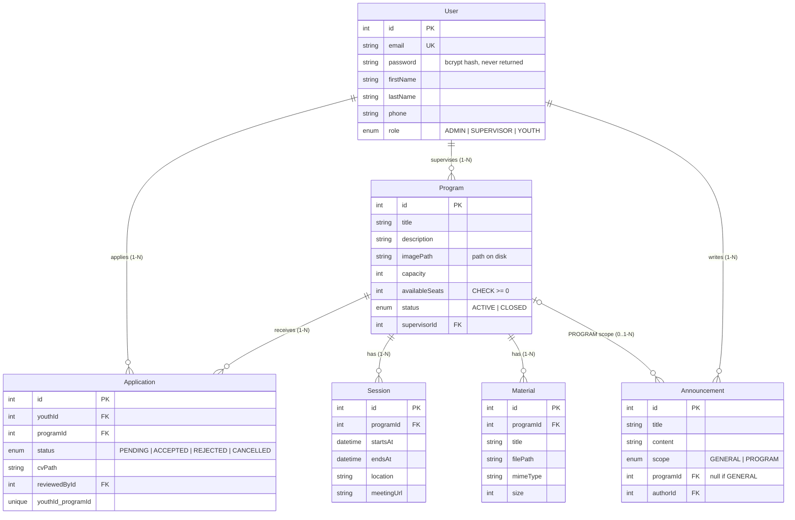

# Sanad Youth API

Backend for the **Sanad Youth for Development** platform. Youth browse training programs, apply (with a CV), and follow their application status. Supervisors manage their own programs, sessions, materials and announcements. Admins manage the whole platform.

**Stack:** NestJS 11 · Prisma 7 · PostgreSQL 17 · JWT · Multer · cache-manager · @nestjs/throttler

---

## 1. Run it

```bash
npm install
docker compose up -d          # PostgreSQL on localhost:5433 (user/pass: sanad/sanad)
cp .env.example .env          # then set JWT_SECRET
npm run db:migrate            # creates the tables
npm run db:seed               # demo data
npm run start:dev             # http://localhost:3000/api
```

| Script | What it does |
|---|---|
| `npm run db:reset` | drop DB, re-apply migrations, re-seed |
| `npm run db:seed` | seed only |
| `npm run test:api` | runs the whole Postman collection from the terminal (79 requests, 106 assertions, all 35 endpoints) |
| `npm run test:last-seat` | **20 youth apply to a 1-seat program at the same instant** |

> Port 3000 busy? Set `PORT=3001` in `.env`, then run the tests with
> `npm run test:api -- --env-var baseUrl=http://localhost:3001/api` and `API_URL=http://localhost:3001/api npm run test:last-seat`.

**Seeded accounts**

| Role | Email | Password |
|---|---|---|
| Admin | admin@sanad.org | Admin@1234 |
| Supervisor | supervisor1@sanad.org, supervisor2@sanad.org | Super@1234 |
| Youth | youth1@sanad.org … youth30@sanad.org | Youth@1234 |

**Postman:** import `postman/sanad-youth.postman_collection.json`, run folder **0. Setup** first, then the others in order. Sample upload files are in `postman/samples/` (set Postman's working directory to the project folder). `sanad-youth-simple.postman_collection.json` is the same collection without stored file paths, for clients that can't import them.

### Tests and the hard cases they cover
| Hard case | Where |
|---|---|
| Last-seat race (20 concurrent applies) | `scripts/last-seat-test.mjs` |
| Seat release after cancel | Postman 1 "Seat returned after cancel", 5 "Youth2 now gets it" |
| Duplicate application | Postman 1 "Apply twice -> 409" |
| Cross-ownership | Postman 3 "Edit another supervisor's program -> 403" |
| Student data isolation | Postman 4 "Youth reads someone else's application -> 404" |
| Materials gate | Postman 1 "Materials while PENDING -> 403" |
| Invalid upload type | Postman 3 "Upload wrong file type -> 400" |
| Brute force | Postman 4 "Wrong password" (send 6x → 429) |
| Stale cache | Postman 2 "Youth sees latest version" |
| Secret leakage | "No password in response" checks across folders |

---

## 2. Entities & relations



- **User ↔ Program is many-to-many** (a youth applies to many programs, a program has many youth). It is resolved by the **`Application`** join table, which also carries data (status, CV, reviewer).
- **Supervisor → Program is one-to-many** (one supervisor, one or more programs).
- One `User` table with a `role` enum instead of three tables: all three roles log in the same way.

---

## 3. Endpoints (prefix `/api`)

Full explanation of every endpoint (body, rules, responses, errors): **[ENDPOINTS.md](ENDPOINTS.md)**.

| Method | Path | Who | Notes |
|---|---|---|---|
| POST | /auth/register | public | always creates a YOUTH · throttled 10/min |
| POST | /auth/login | public | returns JWT · throttled **5/min per email+IP** |
| GET | /auth/me | any | |
| PATCH | /users/me | any | name / phone |
| POST | /users/supervisors | ADMIN | |
| GET | /users?role=&search=&page=&limit= | ADMIN | paginated |
| GET | /programs?search=&status=&page=&limit= | any | paginated + search; youth see ACTIVE only |
| GET | /programs/mine | SUPERVISOR | |
| GET | /programs/:id | any | supervisor name, sessions, **availableSeats** · cached |
| POST | /programs | ADMIN, SUPERVISOR | admin must send `supervisorId` |
| PATCH / DELETE | /programs/:id | owner SUPERVISOR, ADMIN | |
| POST | /programs/:id/image | owner, ADMIN | multipart `image` (jpg/png/webp ≤ 2MB) |
| POST / PATCH / DELETE | /programs/:id/sessions[/:sessionId] | owner, ADMIN | |
| POST | /programs/:id/materials | owner, ADMIN | multipart `file` + `title` (≤ 20MB) |
| GET | /programs/:id/materials | owner, ADMIN, **ACCEPTED youth** | |
| GET | /programs/:id/materials/:mid/download | owner, ADMIN, ACCEPTED youth | |
| POST | /programs/:id/applications | YOUTH | multipart, optional `cv` (PDF ≤ 5MB) · **transaction** |
| GET | /programs/:id/applications | owner, ADMIN | |
| GET | /applications/me?status= | YOUTH | |
| GET | /applications?status=&programId= | ADMIN | |
| GET | /applications/:id · /applications/:id/cv | owner youth, program supervisor, ADMIN | |
| PATCH | /applications/:id/cancel | owner YOUTH | gives the seat back |
| PATCH | /applications/:id/accept · /reject | ADMIN | reject gives the seat back |
| POST | /announcements | ADMIN | general |
| POST | /programs/:id/announcements | owner, ADMIN | program-only |
| GET | /announcements | any | feed: general + my programs · cached |
| GET | /programs/:id/announcements | members | cached |
| PATCH / DELETE | /announcements/:id | author, ADMIN | invalidates cache |

**Application status machine**

```
PENDING ──accept──> ACCEPTED ──cancel──> CANCELLED
   │ └──reject──> REJECTED (seat returned)
   └──cancel──> CANCELLED (seat returned)
```

---

## 4. Where each requirement is used and why

| Requirement | Where | Why there |
|---|---|---|
| **Authentication** | JWT (`passport-jwt`), bcrypt hashes | stateless, any frontend/mobile app can use it |
| **Authorization** | `RolesGuard` (role) + `assertCanManage` / `assertIsMember` in services (ownership) | role alone isn't enough: a supervisor must only touch **his** programs |
| **Transactions** | apply, cancel, accept/reject, capacity change | seat counter and application must change together or not at all |
| **Caching** | program details, announcements | read a lot, edited rarely. Versioned-key invalidation means users always see the latest version after an edit. `availableSeats` is **never cached** |
| **Pagination** | programs, users, applications, announcements | lists grow without limit; `limit` capped at 50 |
| **Throttler** | global 100/min, login 5/min per email+IP, register 10/min | protects against brute force and spam |
| **File upload** | program image, CV, materials | Multer disk storage, MIME + extension whitelist, size limits, random UUID names, **only the path in the DB** |

### The last-seat problem

Naive code does `read seats → if > 0 → create`. With 20 simultaneous requests, many read `1` and all get in. Instead we use one atomic, conditional SQL update inside a transaction:

```sql
UPDATE "Program" SET "availableSeats" = "availableSeats" - 1
WHERE id = $1 AND status = 'ACTIVE' AND "availableSeats" > 0
```

PostgreSQL locks the row, so the requests run one after another, and each re-checks `availableSeats > 0`. Exactly one gets `1 row updated` → **201**. Everyone else gets `0` → **409 "No seats left"**. If creating the application fails (e.g. a duplicate), the transaction rolls the seat back. A DB `CHECK (availableSeats >= 0)` is the last safety net.

### Sensitive data
- Prisma **global `omit`** on `User.password`: the hash is never selected, except in the login query.
- `ValidationPipe({ whitelist, forbidNonWhitelisted })`: sending `"role": "ADMIN"` on register returns 400.
- Server file paths (`cvPath`, `filePath`) are never returned. Files are downloaded only through authorized endpoints.
- Prisma errors are mapped to clean HTTP codes (`PrismaExceptionFilter`), with no SQL in responses.

---

## 5. Project structure

```
src/
  auth/            register, login, JWT strategy
  user/            supervisors, users list, profile
  programs/        programs + sessions + materials (+ ownership helpers)
  applications/    apply / cancel / accept / reject (transactions)
  announcements/   general + program announcements (cached)
  common/          guards, decorators, pagination, cache, upload rules, filters
  prisma/          PrismaService
prisma/            schema, migrations, seed
scripts/           last-seat-test.mjs
postman/           collection
```
